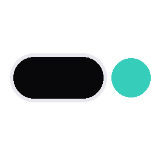
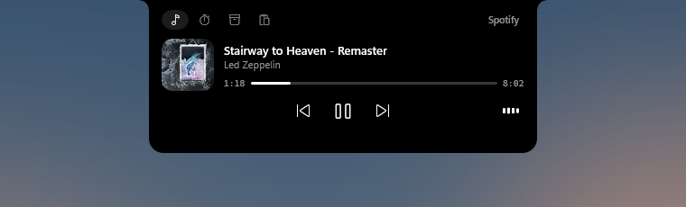
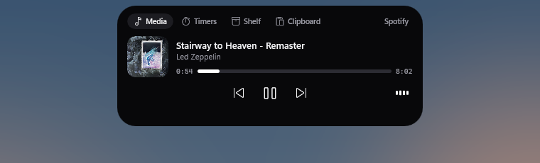
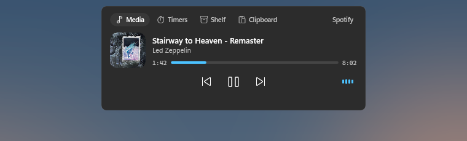
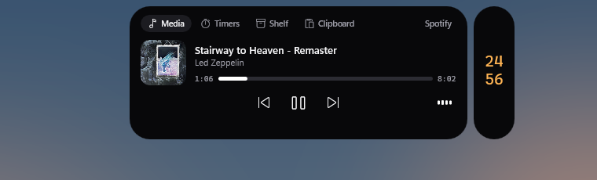
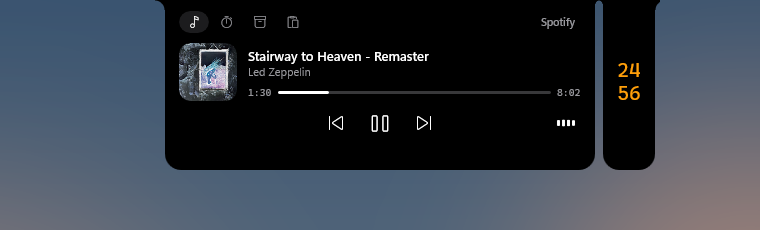
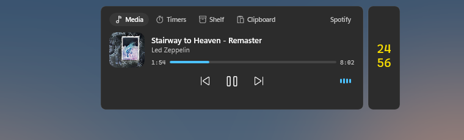

<p align="center"></p>

<h1 align="center">Mora</h1>

<p align="center">The island at the top of your screen. A Dynamic Island for Windows 10 and 11.</p>

<p align="center"></p>

A small pill at the top of the screen shows what is happening right now (music, timers, downloads, devices), opens into a panel of quick controls with a shortcut (Alt + the key above Tab by default, configurable), and gets out of the way. It never takes your keyboard: every key you press keeps going to the app you are in, even while the island opens.

Its name comes from the Malagasy "mora mora": easy, gently.

## Features

- **Music** from any app that reports to Windows (Spotify, browsers, players): artwork shaped by the source, title, progress, controls, and a waveform that follows what actually plays. Track changes pop up for a few seconds.
- **Timers and focus sessions**: plain countdowns, or 25 minute rounds with breaks. A countdown pill sits beside the island while one runs.
- **Shelf**: drop files on the island (or drag them toward the top of the screen) to keep them, then drag them out into any app.
- **Clipboard history** of text and images, kept in memory only, pasted back into the app you are in.
- **Alerts**: finished downloads, headphones connected (with their battery), low battery and charging, microphone or camera in use.
- **Games**: stays out of the way in fullscreen games, with a profile per game for what may show, and an optional music card you control with the arrow keys.
- **Three themes**, each a whole look rather than a palette.

## Themes

| Island | Notch | Fluent |
|---|---|---|
| A black pill floating just below the edge, round ends, a springy entrance. | Grows out of the top edge like a MacBook notch, with curved shoulders, Apple's colors and motion. | A Windows 11 card: follows light or dark mode and your accent color, settles without bouncing. |
|  |  |  |
|  |  |  |
|  |  |  |
|  |  |  |

From top to bottom: the panel, a track change, the resting pill with a running timer beside it, and the panel with the timer pill.

## Install

Builds Mora, installs it for your user in `%LOCALAPPDATA%\Programs\Mora` (no admin rights), adds it to the Start menu and starts it. Run it again to update; settings are kept.

```bash
powershell -ExecutionPolicy Bypass -File install.ps1
```

With "Start Mora when Windows starts" checked (the default, in setup and settings), the installed copy adds itself to `HKCU\Software\Microsoft\Windows\CurrentVersion\Run`. Unchecking it removes the entry. Development builds never write that entry.

To uninstall: Quit Mora from its tray icon, uncheck the start option first (or delete the `Mora` value under that key), then delete `%LOCALAPPDATA%\Programs\Mora`, `%LOCALAPPDATA%\Mora` and the `Mora` shortcut in `%APPDATA%\Microsoft\Windows\Start Menu\Programs`.

## Build and run

Needs the .NET 10 SDK. Visual Studio is not required: the Windows App SDK comes from NuGet and the app runs unpackaged.

```bash
dotnet build src/Mora -c Release -p:Platform=x64
```

```bash
src/Mora/bin/x64/Release/net10.0-windows10.0.19041.0/Mora.exe
```

The first launch opens a 4-step setup. Afterwards, the Mora icon next to the clock opens the island (left click) or a menu with Settings and Quit (right click).

## Keystroke-safety test

Types continuously into its own window while it drives the island through every state: shortcut, clicks on panel buttons, clicks outside, alerts, a clipboard paste done by Mora, a file dragged onto the shelf and back out, and a fullscreen "game". It passes only if every character arrives and its window never loses the foreground. It takes over the mouse and keyboard for about a minute, and restores your clipboard afterwards.

The script runs it against the Debug build with settings of its own (`MORA_DATA`), so your settings are never touched, and starts the installed Mora again at the end:

```bash
powershell -ExecutionPolicy Bypass -File tests/run-keystroke-test.ps1
```

Add `-Theme Notch` or `-Theme Fluent` to run it with another theme.

## Simulating events

For events a machine cannot produce (no Bluetooth headset, no battery), a second launch hands a fake event to the running Mora, which handles it through the same code as the real one:

```bash
Mora.exe --simulate headphones "Headphones (WH-1000XM4)" 72
```

Also `charging 46` (plugged in at 46%), `battery 21 20` (charge dropping from 21% to 20%), `focus 8 6` (a focus session with 8 s rounds and 6 s breaks) and `track "Title" "Artist"` (a track change, with its animation).

## How it is built

C# and WinUI 3 (Windows App SDK, unpackaged), .NET 10. The product brief and the decisions taken while building are in [project.md](project.md).

| Area | Notes |
|---|---|
| Island window | Never activates (`WS_EX_NOACTIVATE`, `MA_NOACTIVATE`), click-through outside the pill (window region follows the shape), follows the monitor of the active window |
| Motion | Damped springs at display rate (open 340/27, close 520/46), interruptible, content fades before the shape shrinks, reduced motion respected |
| Panel | Media (system media sessions: Spotify, browsers, players), Timers (plain countdowns, and focus sessions: 25 min rounds with 5 min breaks, 15 min every 4th), Shelf (also opens when a file is dragged toward the top center), Clipboard (text and images, pasted back into the app you are in) |
| Alerts | Track change, download finished, audio output switch, volume (opt-in), low battery and charging, timer done, clipboard copy. 3 s, held while hovered, queued while the panel is open |
| Games | Fullscreen games only (Windows' Game Bar list, game launcher libraries, exclusive fullscreen, or any app given a profile), a profile for any game and one per game: whether the shortcut opens a music card (arrows switch tracks and set the volume) and which pop-ups may show over the game. The rest is summarised on exit |
| Themes | Island (a black pill floating below the edge), Notch (grows out of the top edge with curved shoulders, Apple's colors and motion, icon tabs), Fluent (a Windows 11 card following light or dark mode and the accent color, no bounce). Picked in Settings, General |
| Setup and settings | First-run setup in 4 steps, settings window from the tray, `%LOCALAPPDATA%\Mora\settings.json` |
| Cost | Idle CPU 0, about 90 MB private memory (WinUI 3 baseline), about 3% of one core while the resting pill animates its waveform |

## Known limits

- Clipboard history lives in memory only (by design) and is cleared on quit. It keeps 8 copies, of which at most 3 images; the panel shows the 3 most recent (the shelf too). The shelf list is saved in `%LOCALAPPDATA%\Mora\shelf.json`.
- Unexpected errors are logged to `%LOCALAPPDATA%\Mora\errors.log` instead of closing the app.
- Monitors with different scaling were not tested (both test monitors were at 100%).
- Native Windows volume and brightness flyouts are not hidden, which is why the volume pop-up is opt-in.
