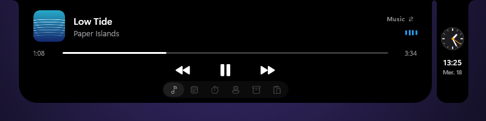
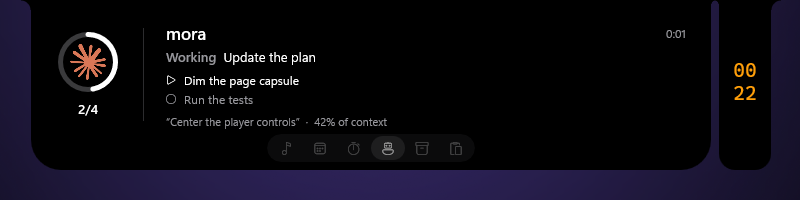

<p align="center"></p>

<h1 align="center">Mora</h1>

<p align="center">The island at the top of your screen. A Dynamic Island for Windows 10 and 11.</p>

<p align="center"></p>

An island grown out of the top of the screen, like a MacBook notch, shows what is happening right now (music, timers, downloads, devices, your coding agents), opens into a panel of quick controls with a shortcut (Alt + the key above Tab by default, configurable), and gets out of the way. It never takes your keyboard: every key you press keeps going to the app you are in, even while the island opens.

Its name comes from the Malagasy "mora mora": easy, gently.

## Features

- **Pages, the way Apple does them**: one at a time straight on the black, turned with the dots at the bottom or the mouse wheel. **Now** (music, like the expanded Dynamic Island), **Today** (the agenda, focus and the weather, like the Lock Screen's widgets), **Timers**, **Agents**, **Shelf** and **Clipboard**.
- **Music** from any app that reports to Windows (Spotify, browsers, players): the cover, title and a waveform on one line, a full-width scrubber, solid controls on the panel's axis, synced lyrics when the song has some, in the cover's color that follows what actually plays. Follows the player that plays; with several open, one tap switches between them. Track changes pop up for a few seconds.
- **Coding agents**: Claude Code connects in one switch. While one works, the island shows it as a live activity: the Claude app's logo in a ring of its progress (its plan as it gets done, or its context in use), orange when it needs you. The Agents page lays them out like the Batteries widget, with each one's plan in words. Mora's crab mascot follows their mood.
- **Timers and focus sessions**: plain countdowns, or 25 minute rounds with breaks, with a sound when one ends.
- **Clock**: a small clock face beside the open panel, the time on the resting pill, in your format.
- **Shelf**: drop files on the island (or drag them toward the top of the screen) to keep them, then drag them out into any app.
- **Clipboard history** of text and images, kept in memory only, pasted back into the app you are in.
- **Notifications** from the apps you pick (Discord, Claude...) shown in the island instead of Windows' corner, and **Do not disturb** from the moon in the panel.
- **Alerts**: finished downloads, headphones connected (with their battery), low battery and charging, microphone or camera in use.
- **Games**: stays out of the way in fullscreen games, borderless included, even while you glance at another screen; a profile per game for what may show, an optional music card you control with the arrow keys, and one summary when the game really ends.

<p align="center"> </p>

## Install

Download `Mora-Setup-1.0.0.exe` from the [latest release](https://github.com/anderson3x11/mora/releases/latest) and run it. It installs Mora for your user only (no admin rights, nothing else to install), adds it to the Start menu and starts it. To update, run the newer installer; your settings are kept.

The installer is not signed yet, so Windows SmartScreen may warn the first time: choose "More info", then "Run anyway".

To uninstall, open Windows Settings > Apps > Installed apps, find Mora and choose Uninstall. It removes the app, its shortcut and its start-with-Windows entry. Your settings and shelf stay in `%LOCALAPPDATA%\Mora`; delete that folder too for a clean slate.

## Build from source

Needs the .NET 10 SDK, and [Inno Setup 6](https://jrsoftware.org/isinfo.php) for the installer (`winget install JRSoftware.InnoSetup`). Visual Studio is not required: the Windows App SDK comes from NuGet and the app runs unpackaged.

Build the self-contained app and the installer into `artifacts\`:

```bash
powershell -ExecutionPolicy Bypass -File release.ps1
```

Or build the installer and install it right away (run again to update):

```bash
powershell -ExecutionPolicy Bypass -File install.ps1
```

For a quick development build without the installer:

```bash
dotnet build src/Mora -c Release -p:Platform=x64
```

```bash
src/Mora/bin/x64/Release/net10.0-windows10.0.19041.0/Mora.exe
```

The first launch opens a 4-step setup. Afterwards, the Mora icon next to the clock opens the island (left click) or a menu with Settings and Quit (right click).

## Keystroke-safety test

Types continuously into its own window while it drives the island through every state: shortcut, clicks on panel buttons, clicks outside, alerts, a clipboard paste done by Mora, a file dragged onto the shelf and back out, and a fullscreen "game". It passes only if every character arrives and its window never loses the foreground. It takes over the mouse and keyboard for about a minute, and restores your clipboard afterwards.

The script runs it against the Debug build with settings of its own (`MORA_DATA`), so your settings are never touched, and starts the installed Mora again at the end:

```bash
powershell -ExecutionPolicy Bypass -File tests/run-keystroke-test.ps1
```

Two more, run the same way, with settings of their own:

- `tests/run-game-mode-test.ps1`: a borderless fullscreen "game" on the main screen while you glance at the other one. Mora must stay quiet the whole time and summarise once, when the game ends (also when it stays minimized for 20 seconds). Takes the mouse for about 45 seconds.
- `tests/run-stress-test.ps1`: two players playing at once, floods of alerts, the panel on every tab, focus rounds, 30 coding agent sessions and 600 events, 150 settings changes, a 1 MB copy. After each phase Mora must still run, with an empty error log and memory that stops growing. No mouse or keyboard, about 5 minutes.

And `dotnet run --project tests/CalendarTest` checks the calendar link reading (time zones, repeats, exceptions, meeting links).

## Simulating events

For events a machine cannot produce (no Bluetooth headset, no battery), a second launch hands a fake event to the running Mora, which handles it through the same code as the real one:

```bash
Mora.exe --simulate headphones "Headphones (WH-1000XM4)" 72
```

Also `charging 46` (plugged in at 46%), `battery 21 20` (charge dropping from 21% to 20%), `focus 8 6` (a focus session with 8 s rounds and 6 s breaks), `track "Title" "Artist"` (a track change, with its animation), `open Agents` and `close` (the panel on a tab), `agent "Title" "Text"` (an agent asking for you) and `settings-chaos 50` (random settings changes, as the stress test does).

## How it is built

C# and WinUI 3 (Windows App SDK, unpackaged), .NET 10. The product brief and the decisions taken while building are in [project.md](project.md). Released under the [MIT license](LICENSE).

| Area | Notes |
|---|---|
| Island window | Never activates (`WS_EX_NOACTIVATE`, `MA_NOACTIVATE`), click-through outside the island (window region follows the shape), follows the monitor of the active window or stays on the main one, finds its place again when screens change |
| Look and motion | The MacBook notch: grown out of the top edge with curved shoulders, pure black, Apple's system colors. Damped springs at display rate (open 380/24, close 560/44), interruptible, content fades before the shape shrinks, reduced motion respected |
| Panel | 680 x 170 with the wide corners of the expanded Dynamic Island, the same for every page; a centered capsule of page icons and the wheel turn them: Now (system media sessions, synced lyrics from LRCLIB), Today (agenda, focus, weather), Timers (plain countdowns, and focus sessions: 25 min rounds with 5 min breaks, 15 min every 4th), Agents, Shelf (also opens when a file is dragged toward the top center), Clipboard (text and images, pasted back into the app you are in) |
| Alerts | Track change, download finished, audio output switch, volume (opt-in), low battery and charging, timer done, clipboard copy. 3 s, held while hovered, queued while the panel is open |
| Games | Fullscreen games only (Windows' Game Bar list, game launcher libraries, exclusive fullscreen, or any app given a profile), a profile for any game and one per game: whether the shortcut opens a music card (arrows switch tracks and set the volume) and which pop-ups may show over the game. The rest is summarised on exit |
| Coding agents | Claude Code's hooks post each step to `127.0.0.1:47115` with `curl` in the background (installed and removed from Settings, nothing else in its settings file touched). Agent logos are the installed apps' own icons, drawn by Windows. The live activity takes the resting island, never during games. Agent redraws are batched (at most every 250 ms) and one timer animates every crab and pulse |
| Setup and settings | First-run setup in 4 steps, settings window from the tray, `%LOCALAPPDATA%\Mora\settings.json` |
| Cost | Idle CPU 0, about 90 MB private memory (WinUI 3 baseline), about 3% of one core while the resting pill animates its waveform |

## Known limits

- Clipboard history lives in memory only (by design) and is cleared on quit. It keeps 8 copies, of which at most 3 images; the panel shows the 3 most recent (the shelf too). The shelf list is saved in `%LOCALAPPDATA%\Mora\shelf.json`.
- Unexpected errors are logged to `%LOCALAPPDATA%\Mora\errors.log` instead of closing the app.
- Monitors with different scaling were not tested (both test monitors were at 100%).
- Native Windows volume and brightness flyouts are not hidden, which is why the volume pop-up is opt-in.
